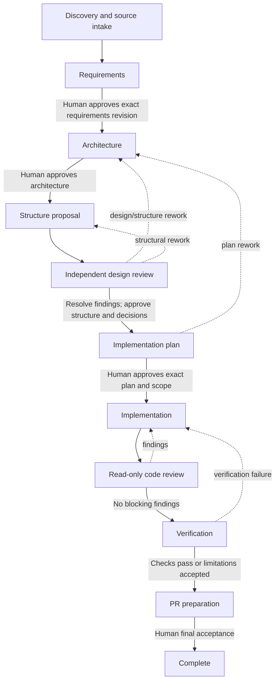

# Workflow Architecture

This document defines the pipeline's generic workflow contract. A run is scoped to one confirmed target repository and, for a monorepo, an identified module. Application language and tools are discovered from evidence; nothing in the pipeline mandates a target stack.

## Stages and approvals

| Transition | Required evidence/gate |
| --- | --- |
| Discovery → requirements | Confirmed target, target classification, story source, and discovery evidence. A required source failure remains blocked. |
| Requirements → architecture | Requirements and acceptance criteria link to source IDs; human approval references the exact requirements revision. |
| Architecture → structure planning | Architecture decision/evidence artifact; human approval of its exact revision. |
| Structure planning → design review | Proposed tree names reuse/modify/add paths, purpose, requirement IDs, module scope, and dependency/config impacts. No directories are created. |
| Design review → planning | Independent findings are resolved or accepted; structure plan and material design decisions are human-approved. |
| Planning → implementation | Dependency-ordered task IDs trace to requirements, approved structure, and checks; human approves exact plan and scope. |
| Implementation → review | Implementer reports task IDs, changed paths, and actual local checks. |
| Review → verification | Read-only review has no unresolved blocker/high finding; dispositions have evidence. |
| Verification → PR preparation | Actual command/results recorded; failed checks route back; limitations are explicit and accepted where necessary. |
| PR preparation → complete | PR materials contain actual changed files and test evidence; human final acceptance. PR creation remains separate authorization. |

## Agent Responsibilities

All tools below are VS Code tool groups. The source retriever's MCP tool IDs are intentionally not hardcoded; the operator enables individually verified read-only tools for the session. External write tools are not part of the agent set.

| Agent | Inputs | Output | Allowed tools | Handoff condition |
| --- | --- | --- | --- | --- |
| SDLC Orchestrator | Story, target, state, artifacts | State transitions, delegated work, gates, blockers/rework | `agent`, `read`, `search`, `edit`, `execute` | Delegates only after checking prerequisites; stops at human gates |
| source-retriever | Capability, resource, confirmed read mapping | Source record with provenance, completeness, errors | `read`, `search` only in shipped profile; no MCP tool is enabled | Returns direct/local data; MCP requires a reviewed allow-list update |
| requirements-analyst | Story and source records | Traceable requirements and questions | `read`, `search` | Returns content; orchestrator persists; human approves exact revision |
| architecture-designer | Approved requirements and repository evidence | Architecture options/decisions and risks | `read`, `search` | Returns content; orchestrator persists; human approval before structure planning |
| project-structure-planner | Approved architecture, requirements, stack/module evidence | Proposed tree and per-path rationale; no creation | `read`, `search` | Returns content; orchestrator persists; design review; structural edits require approval |
| design-reviewer | Requirements, architecture, proposed structure | Independent findings/dispositions needed | `read`, `search` | Returns content; orchestrator persists; blocking findings route to architecture/structure |
| implementation-planner | Approved design/structure and review | Dependency-ordered, traceable tasks | `read`, `search` | Returns content; orchestrator persists; human approves plan/scope before implementation |
| implementer | Approved plan/task IDs and target scope | Minimal changes, changed paths, checks | `read`, `search`, `edit`, `execute` | Sends completion to read-only reviewer; scope changes pause |
| code-reviewer | Approved requirements/plan and change revision | Findings-first review report | `read`, `search` | Returns content; orchestrator persists; findings route to implementation/planning |
| test-verifier | Acceptance criteria, changes, discovered commands | Actual verification evidence and limitations | `read`, `search`, `execute` | Returns content; orchestrator persists; failure routes back |
| pr-preparer | Approved changes, review and verification evidence | PR summary/checklist artifact only | `read`, `search` | Returns content; orchestrator persists; human reviews; no API PR create/merge/push |

Subagents are bounded workers, not independent workflow coordinators. Only the orchestrator updates workflow state and chooses the next stage.

## Repository and Structure Adaptation

The target must be confirmed before discovery. Inspect target instructions, Git root/status, manifests/configuration, source/test directories, CI, and relevant code. Record evidence for each detected language, framework, build system, package manager, dependency, convention, and test command.

- **Empty target:** record that no stack is present. Architecture proposes options based on requirements; ask the human to choose material technology decisions. Structure planner proposes a minimal tree only after approval.
- **Existing target:** follow local architecture and conventions. Structure output separates reuse, modify, and add paths, and flags configuration/dependency impacts. Avoid recreating structure and unrelated refactoring.
- **Monorepo:** inspect root and candidate modules, select a module using story paths and repository evidence, record the workspace-relative module scope, and respect shared boundaries. Ask when the correct module is ambiguous.

The structure planner produces `structure-plan.md` before any app directories or files are created. Human approval references the exact revision and approved paths. This is a gate in instructions and in the JSON validator; workspace tools themselves are not a filesystem sandbox.

## Persistent State, Artifacts, and Rework

The machine-readable `workflow-state.json` is authoritative; conversation history is not. Create it from `templates/workflow-state.template.json` at `.sdlc/<run-id>/workflow-state.json`. It records target/module, stack evidence, source provenance, stage/status, requirements/task IDs, artifact paths/revisions, active artifact IDs/revisions, prerequisites, human approvals, blockers, review findings, verification evidence, and rework history. User-facing artifacts use the corresponding templates under `templates/`. Historical approvals remain records but only an approval tied to the active artifact ID and revision satisfies a gate.

`python scripts/validate_workflow.py --root . --state <state-path>` validates customization metadata and the saved state. Add `--next-stage <stage>` to check a proposed transition. The validator checks prior-stage artifacts and approvals, exact human-approved revisions, IDs/traceability, source failures/conflicts, blockers, review severity, and verification outcomes. It does not run target tests or authenticate to MCP.

Changed requirements invalidate linked downstream artifacts. Failed review/verification routes to the earliest responsible stage. Incomplete external data remains a blocker or a documented user-approved fallback; it is never silently promoted to complete.

## External Actions

MCP is optional and provider-neutral. Source retrieval is read-only by default. Local file edits and tests use local tools. Commits, pushes, merges, external writes, and PR creation each require separate explicit human authorization; the PR preparer produces documentation only.